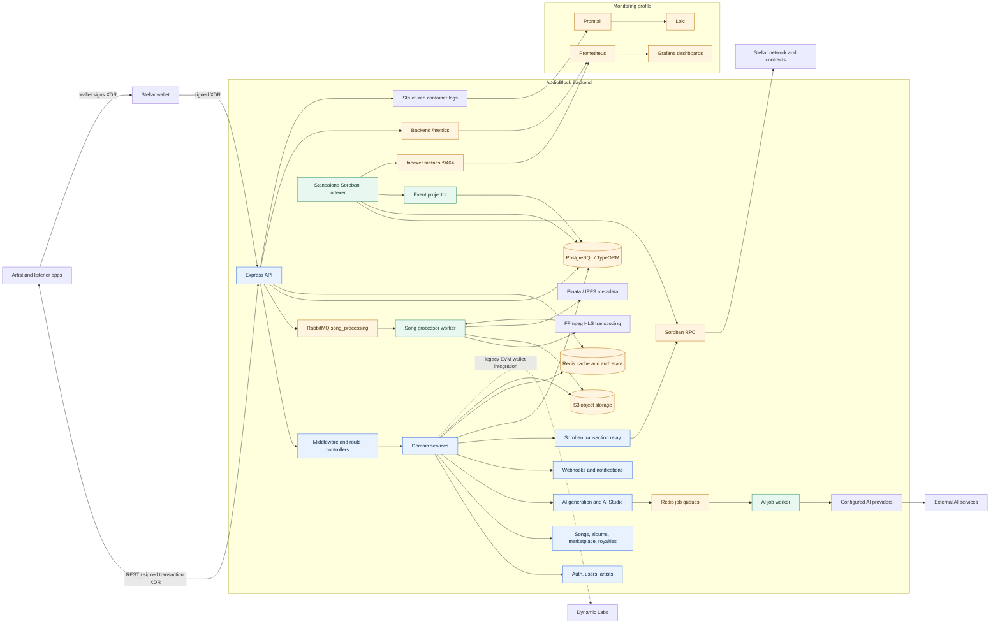

# AudioBlock Backend Architecture

The API can start without RabbitMQ; song processing remains unavailable until
the queue and worker connect. AI jobs are independently queued through Redis.
The indexer runs as a separate process and can be disabled with
`INDEXER_ENABLED`. For on-chain writes, the client wallet signs the prepared
transaction; the backend relays signed XDR and never holds the artist's Stellar
secret key. Prometheus alert rules are maintained in
[`monitoring/prometheus-alerts.yml`](../monitoring/prometheus-alerts.yml).
